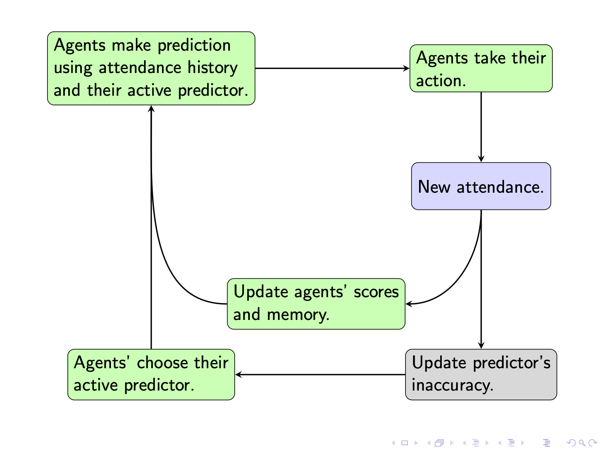
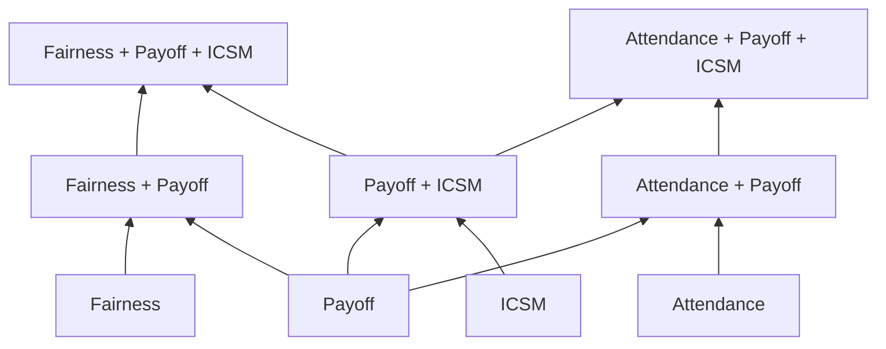

# Iterative Cognitive Schema Matching

This project contains the computational models that implement an agent-based model of the El Farol Bar Problem (Arthur, 1994). Each agent decides to stay home or go to the bar. A model first scores the two actions, then turns those scores into probabilities with a softmax:

$$
\pi(a \mid \mathcal{S}, m, \theta)
=
\frac{\exp\!\big(\beta \cdot \mathrm{preference}(a, \mathcal{S}, m, \theta)\big)}
{\sum_{b \in \{\mathrm{stay},\, \mathrm{go}\}}
\exp\!\big(\beta \cdot \mathrm{preference}(b, \mathcal{S}, m, \theta)\big)}
$$

where $\beta$ is the inverse temperature, and $\mathrm{preference}(a, \mathcal{S}, m, \theta)$ is how strongly model $m$ with parameters $\theta$ favors action $a$ after information state $\mathcal{S}$ (the previous round or rounds).



Each round follows that loop. Agents predict attendance from who went in earlier rounds and from the predictor they are currently using. They then stay or go. The formula above is that choice: the active predictor scores the two actions, and the softmax turns those scores into a probability. A larger $\beta$ makes the higher-scored action more likely. On the first round there is no history, so the choice is random.

The actions in a round produce a new attendance. From there the loop splits. One branch records each agent's score and adds the round to memory, which is what the next prediction reads. The other branch records how far the active predictor was from the attendance that actually occurred. Agents can then drop that predictor for one that has been less wrong, and the next round starts from that choice.

Most learning rules come in three variants, which differ only in what they treat as $\mathcal{S}$:

| Variant | What the agent conditions on |
| --- | --- |
| M1 | Nothing from the previous round |
| M2 | Its own last action and how many others went |
| M3 | The full list of who went |

The models combine four ideas. Single ideas sit on the first row. Rows below mix those ideas.



All models are defined in `src/Classes/cognitive_model_agents.py`:

| Model | Code | Idea | In lattice |
| --- | --- | --- | --- |
| ICSM | `FocalRegionAgent` | Match patterns in who went recently | Yes |
| Payoff | `PayoffM1`, `PayoffM2`, `PayoffM3` | Repeat actions that paid off | Yes |
| Attendance | `OnlyAttendanceM1`, `OnlyAttendanceM2`, `OnlyAttendanceM3` | Repeat actions that raised how often the agent got in | Yes |
| Fairness | `OnlyFairnessM1`, `OnlyFairnessM2`, `OnlyFairnessM3` | Move attendance toward an even share | Yes |
| Attendance + Payoff | `AttendanceM1`, `AttendanceM2`, `AttendanceM3` | Payoff and attendance together | Yes |
| Fairness + Payoff | `FairnessM1`, `FairnessM2`, `FairnessM3` | Payoff and fairness together | Yes |
| Payoff + ICSM | `PayoffICSMM1`, `PayoffICSMM2`, `PayoffICSMM3` | Payoff and pattern matching | Yes |
| Attendance + Payoff + ICSM | `AttendancePayoffICSMM1`, `AttendancePayoffICSMM2`, `AttendancePayoffICSMM3` | Payoff, attendance, and pattern matching | Yes |
| Fairness + Payoff + ICSM | `FairnessPayoffICSMM1`, `FairnessPayoffICSMM2`, `FairnessPayoffICSMM3` | Payoff, fairness, and pattern matching | Yes |
| FS + Payoff + Attendance | `FRAplus` | Pattern matching mixed with the M2 attendance and payoff rule | No |
| Available space | `AvailableSpaceM1`, `AvailableSpaceM2`, `AvailableSpaceM3` | Go more when others leave room, stay when they fill it | No |
| Win-stay, lose-shift | `WSLSM1`, `WSLSM2`, `WSLSM3` | Keep an action after a good result, switch after a bad one | No |
| Markov fictitious play | `MFPM1`, `MFPM2`, `MFPM3` | Count how often the bar had room after each situation, and go when that seems likely | No |
| Random | `Random` | Go with a fixed probability | No |
| Priors | `PriorsM1`, `PriorsM2`, `PriorsM3` | A separate fixed go probability for each situation | No |

`Priors` is defined in the code but left out of the `MODELS` list used for fitting.

## How to run

From the project folder, set up a Python environment and install the packages:

```bash
python -m venv .venv
source .venv/bin/activate
pip install -r requirements.txt
pip install jupyter
```

Start Jupyter from the `Notebooks` folder. The notebooks look for data and results one level up from there.

```bash
cd Notebooks
jupyter notebook
```

Open a notebook and run the cells from top to bottom:

- `Fit_models_to_human_data.ipynb` compares the three ideas with the recorded choices.
- `Best_fits.ipynb` shows the closest matches.
- `Fig5.ipynb` draws the comparison figure.
- `AIC_model_lattice.ipynb` compares combinations of the ideas.

## Directory structure

```
ICSM/
├── src/                          # Simulation, agents, and fitting code
│   ├── Classes/
│   │   ├── agents.py             # Base agent types
│   │   ├── agent_utils.py
│   │   ├── bar.py                # Bar environment
│   │   ├── cognitive_model_agents.py  # ICSM, payoff, and attendance policies
│   │   ├── focal_regions.py      # Focal schemata and regions
│   │   ├── NN.py
│   │   └── parameter_recovery.py # Likelihoods and parameter fits
│   ├── Config/
│   │   └── config.py             # Paths and shared settings
│   └── Utils/
│       ├── bar_utils.py
│       ├── cherrypick_simulations.py
│       ├── eq_coop_utils.py
│       ├── indices.py
│       ├── interaction.py        # Episodes and experiments
│       ├── LaTeX_utils.py
│       ├── parameter_optimization.py
│       ├── plot_utils.py
│       ├── unit_tests.py
│       └── utils.py
├── Notebooks/
│   ├── AIC_model_lattice.ipynb   # AIC lattice over mechanism combinations
│   ├── Best_fits.ipynb
│   ├── Fig5.ipynb                # Mechanism comparisons for Figure 5
│   └── Fit_models_to_human_data.ipynb
├── data/
│   ├── human/                    # Empirical attendance data
│   ├── simulated/                # Model-generated attendance series
│   ├── focal_regions/
│   ├── empirical_focal_regions/
│   ├── indices/
│   └── likelihoods/
├── reports/
│   └── MLE/                      # Maximum-likelihood fit summaries
├── images/
│   ├── bar_images/
│   └── exploratory/
├── Figures for article/
├── LaTeX/
├── diagram.png                   # Round loop shown above
└── requirements.txt
```
